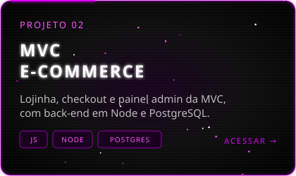

<!---
Os SVGs são gerados por assets/build.py (e assets/contrib.py, todo dia, pela automação).
Edite os textos lá e rode:  pip install fonttools brotli && python assets/build.py
O site fica em index.html (GitHub Pages).
--->
